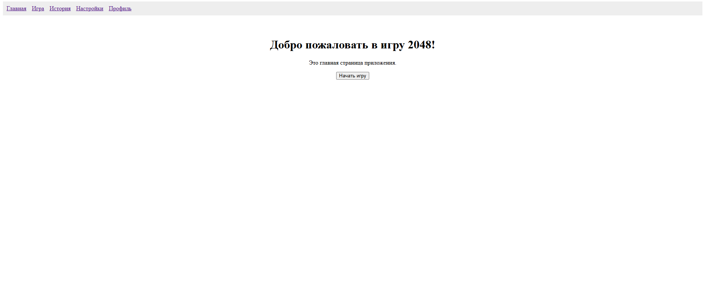
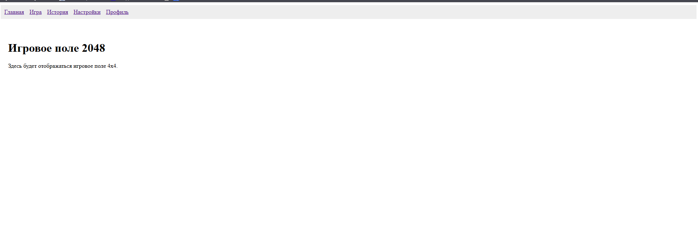

# 2048 Coursework

Курсовая работа: разработка игры 2048 с отменой хода и сохранением прогресса.

## Структура проекта

Проект реализован как монорепозиторий (npm workspaces) и состоит из двух пакетов:

- **`packages/app`** — основное приложение (React + TypeScript + Vite + React Router)
- **`packages/ui-library`** — библиотека переиспользуемых UI-компонентов

## Инструкция по запуску

### Установка зависимостей

```bash
npm install
```

### Запуск в режиме разработки

```bash
npm run dev
```

Приложение откроется по адресу http://localhost:5173

### Сборка проекта

```bash
npm run build
```

### Тестирование и линтинг

```bash
npm run test
npm run test:coverage
npm run lint
npm run lint:fix
```
Покрытие тестами библиотеки общих компонентов (`Button`) составляет 100% по всем столбцам.

## Скриншоты работы приложения

### Главная страница



### Игровое поле



## Документация

- [Архитектурные требования](architecture.md)
- [Функциональные требования к MVP](mvp.md)